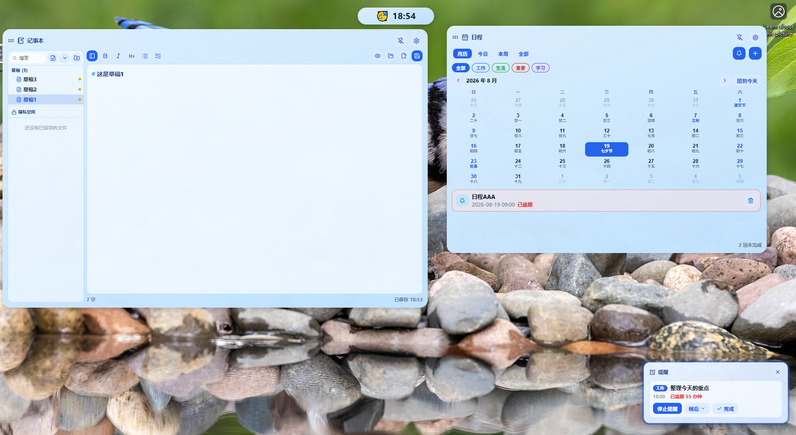
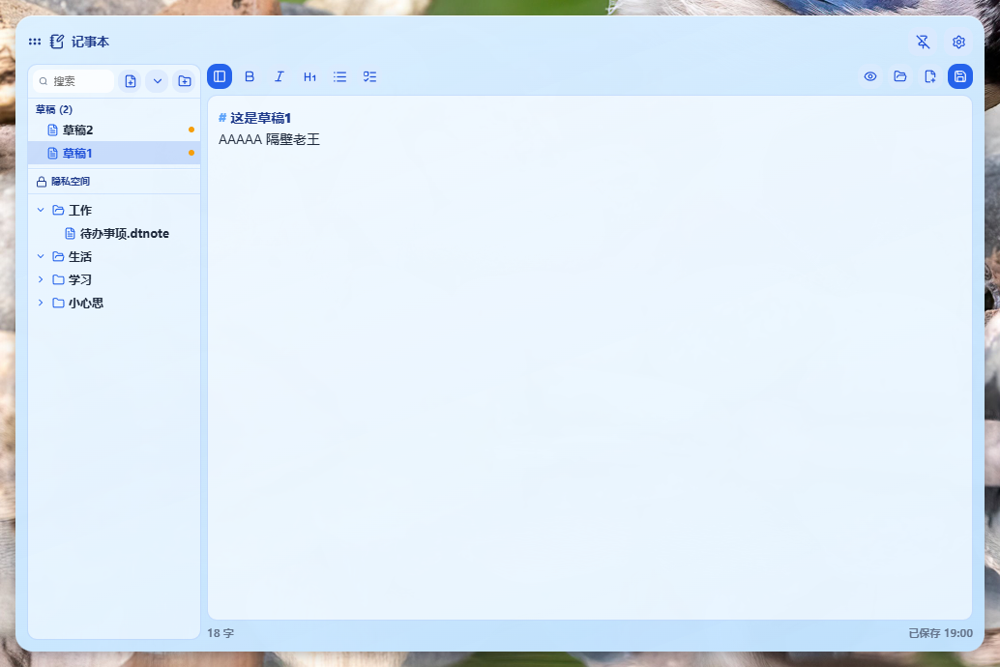
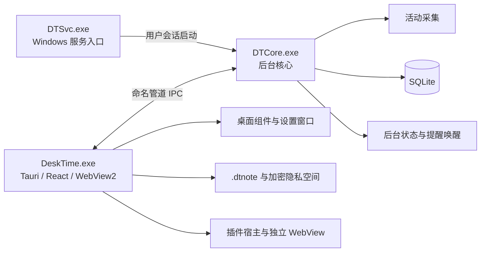

# DeskTime

DeskTime 是一款面向 Windows 的本地桌面效率工具。它把时钟、日程、提醒、Markdown 记事本、活动统计和桌面小组件组合在一起，以轻量浮窗的形式常驻桌面。

项目基于 React 19、TypeScript、Vite、Tauri 2 和 Rust 构建，界面运行在 WebView2 中；主要业务数据保存在本机，不依赖在线账户。

## 产品界面

### 桌面总览

记事本、月历日程、灵动岛时钟和提醒窗口可以独立显示、移动、置顶或隐藏。



### 记事本与隐私空间

记事本支持草稿、虚拟文件夹、Markdown 编辑、图片粘贴、自动保存、笔记模板和加密隐私空间。



## 主要功能

- **时钟与日历**：多时区时钟、农历与节气、番茄钟、整点提醒和月历视图。
- **日程与提醒**：标签分类、重复日程、提前提醒、稍后提醒、完成状态和独立置顶提醒窗口。
- **桌面记事本**：CodeMirror Markdown 编辑器、预览、格式工具栏、图片粘贴、自动保存和文件树管理。
- **单文件笔记**：正文和图片保存在 `.dtnote` 容器中，便于移动、备份和恢复。
- **隐私空间**：使用 PBKDF2-HMAC-SHA-256 与 AES-256-GCM 加密笔记内容、文件名和目录结构，密钥仅保留在 Rust 进程中。
- **牛马时钟**：结合工作时间、活动记录和薪资设置展示实时时薪、工作状态与日报。
- **活动统计**：在本机采集前台应用和输入活跃度，按分钟聚合，不记录具体按键内容。
- **桌面与启动器**：桌面层、应用启动器、全局快捷键、主题和多语言设置。
- **插件系统**：支持独立插件窗口、设置项和 JSON-RPC 后端；内置系统监控及实验性网页视频小窗示例。

## 整体架构



三个可执行程序共用同一个 Rust library：

- `DeskTime.exe` 负责界面、窗口、笔记、隐私空间和插件宿主。
- `DTCore.exe` 负责活动采集、SQLite 数据、后台状态和 IPC 服务。
- `DTSvc.exe` 负责以 Windows 服务身份在用户会话中启动后台核心。

前端代码位于 `src/`，Rust 后端位于 `src-tauri/src/`，内置插件位于 `plugins/`。更详细的边界和安全约束见 [Rust 后端架构](src-tauri/ARCHITECTURE.md)。

## 安装

DeskTime 当前面向 Windows 10/11 x64，需要 Microsoft Edge WebView2 Runtime。运行 NSIS 安装包并按提示完成安装即可；覆盖安装前建议先从托盘完全退出正在运行的 DeskTime。

本地正式构建后，安装包位于：

```text
src-tauri/target/release/bundle/nsis/DeskTime_<版本号>_x64-setup.exe
```

## 本地开发

准备 Node.js、npm、Rust stable、MSVC C++ 构建工具和 WebView2 开发环境，然后执行：

```powershell
npm install
npm run tauri:dev
```

常用检查命令：

```powershell
npm run lint
npm run build
cd src-tauri
cargo test
```

正式打包会自动递增补丁版本号，并重新构建 `DTCore.exe`、`DTSvc.exe` 和 NSIS 安装包：

```powershell
npm run tauri:build
```

## 数据与隐私

- 配置、日程、活动数据、笔记和插件数据默认保存在本机。
- 活动采集不保存具体按键内容，也不采集输入文本。
- 隐私笔记在磁盘上以密文保存；锁定后前端只保留不可用的会话状态。
- LLM 功能默认关闭，仅在用户配置接口并主动启用后访问对应服务。
- 用户配置、数据库、密钥、日志、浏览器 profile 和隐私空间数据均已从 Git 版本控制中排除。
